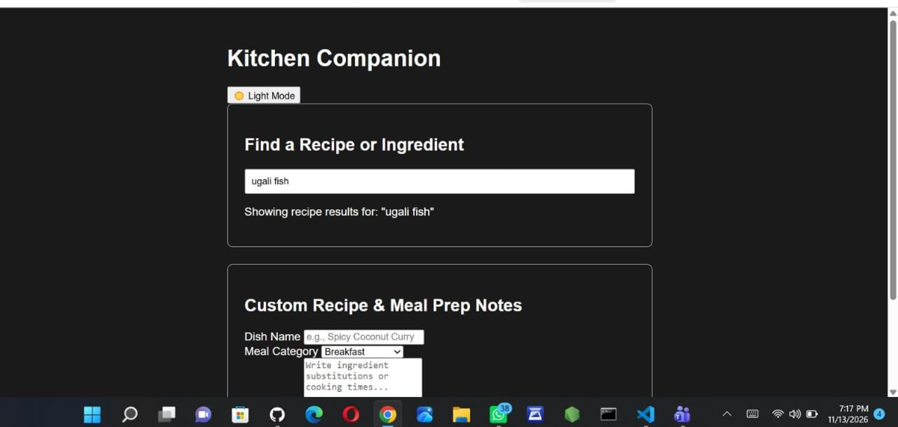

# Week 7: Advanced To-Do List 

## Author
- **Name:** Caroline Wanjira
- **GitHub:** [@Caroline-wanjira](https://github.com/Caroline-wanjira)
- **Date:** November 13, 2026

## Project Description
I expanded my To-Do List application and a Recipe Finder web app. It applies modern JavaScript best practices,  error handling, and browser storage—to create a reliable, user-friendly experience across page reloads.

## Technologies Used
- HTML5 
- CSS3 
- JavaScript 
- Vitest 
- ESLint & Prettier
- Git & GitHub

## Features
- Advanced To-Do List
- Switches between light and dark modes while saving the user's preference.
- Recent Recipe Searches which tracks the last 5 searches in a dropdown history for quick re-searching.
- Form Auto-Save that automatically saves recipe and meal prep form drafts as the user types, restores them on page refresh, and clears storage upon submission.

## How to Run
1. Clone this repository:
   ```bash
   git clone [https://github.com/Caroline-wanjira/iyf-s12-week-07-Caroline-wanjira.git](https://github.com/Caroline-wanjira/iyf-s12-week-07-Caroline-wanjira.git)
   ```
2. To run the automated unit tests:
   ```bash
   npm install
   npm test
   ```

## Lessons Learned
- Learned how to use the browser developer console to trace bugs back to the exact line of code instead of guessing what went wrong.
- I learnt writing Cleaner Code Using ESLint which taught me the importance of consistent formatting, using `const` and `let` properly, and removing unused variables so my code is easier to read and maintain.

## Challenges Faced
- At first, my linter flagged several formatting issues and unused variables. Going through them one by one helped me understand why clean syntax matters.
-  While advancing the To-Do list, I ran into console errors where JavaScript tried to access HTML elements or update items before they were properly rendered on the page. Debugging fixed the issue.

## Collaboration 
- **PR I opened:** https://github.com/Caroline-wanjira/iyf-s12-week-07-Caroline-wanjira/pull/1


## Screenshot


## Live Demo 
[To-Do List](https://caroline-wanjira.github.io/iyf-s12-week-07-Caroline-wanjira/)
